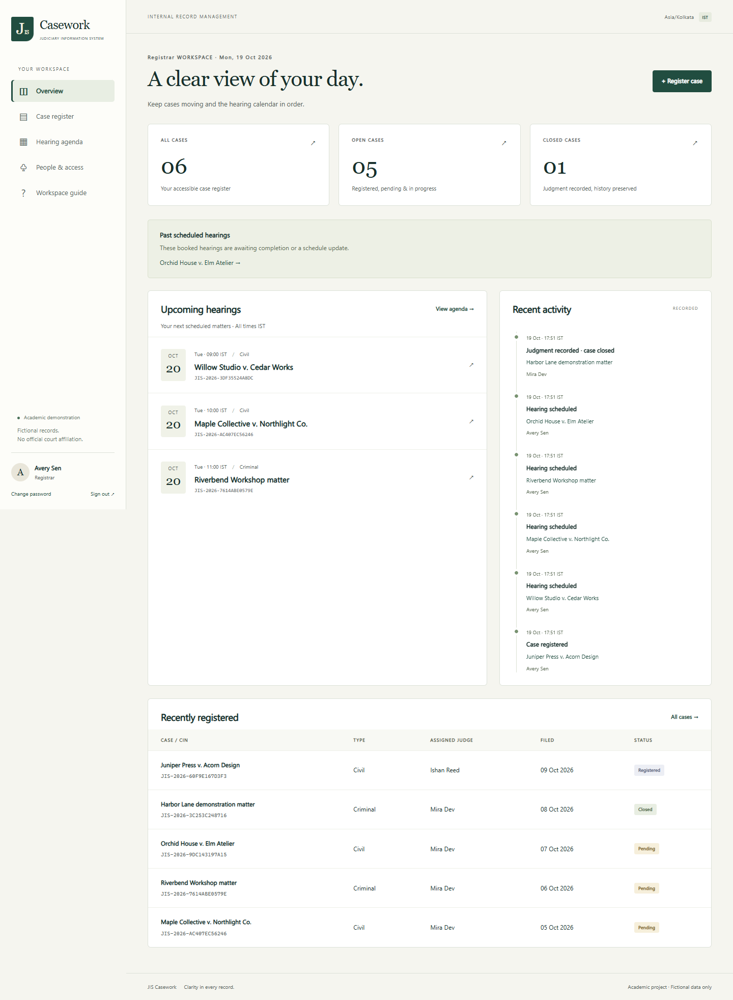
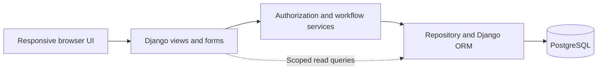
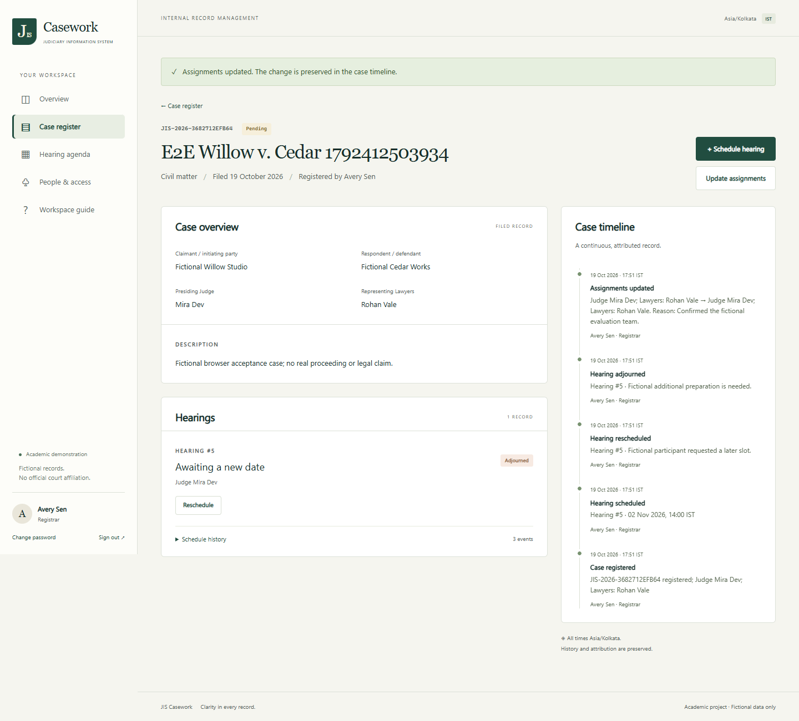
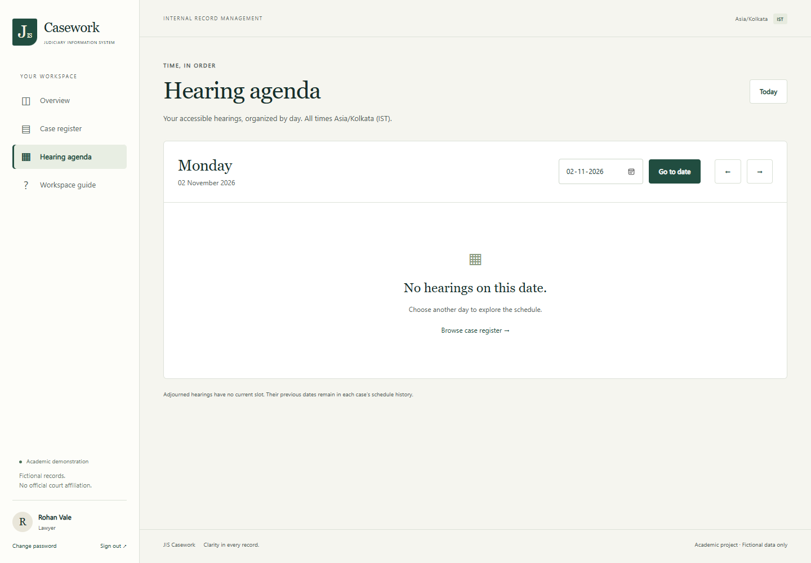
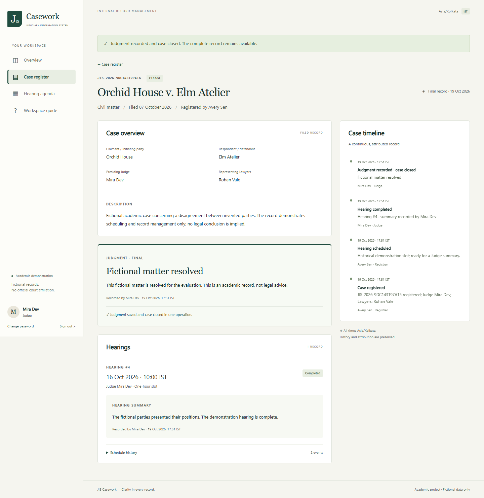
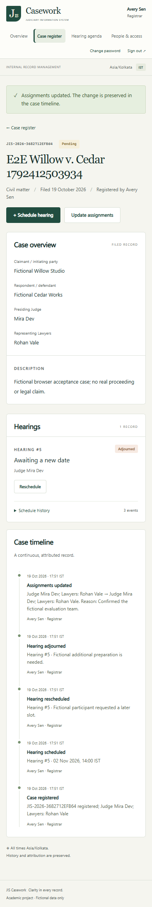

<div align="center">

# JIS Casework
### A case lifecycle with accountability at every step.

Internal judiciary record management · Hearing scheduling · Role-based access

[](https://github.com/vermakkrish/JIS-Casework/actions)


[Explore the workflows](#what-you-can-do) · [Run locally](#local-setup) · [Review the architecture](docs/architecture.md) · [See test evidence](docs/test-report.md)

</div>



**JIS Casework** turns a Software Engineering specification into a working, database-backed application: register a case, assign its Judge and Lawyers, manage hearing changes, and record a judgment that closes the case atomically. Each role gets a focused interface, while the server and database enforce the rules behind it.

Built as a three-person, third-year B.Tech CSE (Data Science) project. All demonstration records are fictional. This is an academic system, with no official court affiliation or claim of legal accuracy.

> **Project status:** implemented and locally verified. Public deployment is paused at the project owner's request; there is no verified live URL. Hosting configuration is included, but Docker execution, hosted smoke tests, and a backup-restore rehearsal remain pending.

## What you can do

| Role | Supported workflows |
|---|---|
| **Registrar** | Register cases with unique CINs; assign Judges and Lawyers; schedule, reschedule and adjourn hearings; search all cases; create and deactivate Judge/Lawyer accounts. |
| **Judge** | View assigned cases; record hearing summaries; submit a verdict and judgment summary that closes the case in one transaction. |
| **Lawyer** | Search assigned cases and read case details, hearing history and judgments. No write access. |

Every role has a dashboard and a hearing agenda. Case detail pages connect registration, scheduling changes, summaries and closure in a readable timeline. Hearing times are labelled **Asia/Kolkata**, with timezone-aware timestamps stored by Django.

## Engineering decisions that matter

- **Atomic closure:** judgment creation, case closure and the audit event succeed together or roll back together. Database triggers provide an additional integrity boundary.
- **Concurrency-safe identifiers and scheduling:** database uniqueness protects CINs, Judge/time slots and the single current booking per case. Threaded tests exercise simultaneous registrations and competing bookings.
- **Server-side authorization:** access checks apply to reads and writes, including direct HTTP requests. Assignment-scoped queries prevent Judges and Lawyers from browsing other cases.
- **History without destructive account deletion:** deactivation revokes access while protected references preserve registration, assignment and judgment attribution.
- **Explicit state transitions:** cases and hearings have separate state machines. Closed cases reject normal mutations; rescheduling and adjournment require reasons and retain before/after history.
- **Practical security:** Argon2id password hashing, database sessions, CSRF protection, login throttling, input validation and hardened production settings. Credentials stay out of the repository.



The application uses server-rendered templates and a small amount of JavaScript: no separate frontend service is required. Transactions and business rules live in the service layer; versioned migrations define constraints and integrity triggers.

## Product walkthrough

| Case detail and timeline | Hearing agenda |
|---|---|
|  |  |

<details>
<summary><strong>View judgment and mobile screenshots</strong></summary>





</details>

## Verification at a glance

The checked-in [verification report](docs/test-report.md) records local checks from **19 October 2026**; these are measured results, not a claim about an untested hosted environment.

| Check | Recorded result |
|---|---|
| PostgreSQL backend suite | **27/27 passed**, including concurrent registration and scheduling tests |
| Browser acceptance | **9/9 groups passed**, covering all three roles and R1–R7 |
| Automated accessibility | **0 violations** across five axe scans; not a full accessibility certification |
| Responsive layout | Desktop 1440 × 1000 and mobile 390 × 844 checked |
| Persistence | Seven-table record digest matched before and after PostgreSQL restart |
| Build and configuration | Static collection, Python compilation, migration drift and production Django checks passed |
| Corrected models | **12** editable DOT diagrams parsed and rendered to SVG |

**Search measurement:** 5,006 cases, five warmups and 50 serial requests per role against local PostgreSQL. The highest role-specific p95 was **38.93 ms**, and the highest single request was **41.11 ms**. Measurements include Django authentication, queries and template rendering, but exclude network, TLS and browser painting. See [raw benchmark conditions](docs/evidence/search-performance.json).

GitHub Actions runs the PostgreSQL backend suite, diagram rendering and Chromium acceptance checks on pushes and pull requests. The badge above shows the current CI result independently of the historical local evidence.

## Documentation map

| Document | What it covers |
|---|---|
| [Requirements and decisions](docs/requirements-and-decisions.md) | R1–R7, scope, assumptions and resolutions of source-model inconsistencies |
| [Architecture and data dictionary](docs/architecture.md) | Layers, entities, relationships and integrity rules |
| [Traceability matrix](docs/traceability.md) | Requirements → implementation → tests |
| [Corrected UML and data-flow models](docs/diagrams/) | 12 source/render pairs; open `index.html` locally for the viewer |
| [Presentation diagrams](docs/presentation-diagrams/) | Additional class and registration activity diagrams in PNG/SVG |
| [Test report](docs/test-report.md) | Expected/actual outcomes, evidence and explicit verification limits |
| [User guide](docs/user-guide.md) | Role workflows, account setup, passwords and fictional data reset |
| [Seven-minute team demo](docs/evaluator-demo.md) | A presentation divided among three students |
| [Deployment runbook](docs/deployment.md) | Prepared hosting configuration, secrets, migrations, backup and restore |

## Stack and reasons

Python 3.12, Django 5.2 LTS, PostgreSQL 18, server-rendered HTML/CSS with small progressive-enhancement JavaScript, Argon2id passwords, database sessions, Gunicorn and WhiteNoise. Django supplies validated forms, CSRF, session authentication, ORM and migrations in one understandable codebase. PostgreSQL supplies persistent relationships, uniqueness, transactions, and row locks. SQLite is an optional local convenience; **production refuses SQLite**. Node is needed only for browser tests and diagram rendering.

The core flow is presentation/HTTP → application services → repository/ORM → database. Consequential writes cannot skip the service authorization and transaction boundary. The database independently protects key integrity rules, including judgment-triggered closure. See the architecture document for the deliberate use of lightweight ORM reads.

## Prerequisites

- Python 3.12 or 3.13 with pip and venv.
- PostgreSQL 18 for production-equivalent verification. Docker Compose is optional; its file is included. SQLite can run a quick local preview.
- Node.js 22+ for `npm ci`, Playwright and diagrams. No Node server or browser build is needed for the application.
- A modern supported browser. Verification used Microsoft Edge/Chromium at desktop and mobile viewport widths.

## Local setup

Clone the repository, then run commands from the project root:

```bash
git clone https://github.com/vermakkrish/JIS-Casework.git
cd JIS-Casework
```

 The app reads exported environment variables; it does **not** automatically load `.env`. `.env.example` lists the variables without real credentials.

```powershell
python -m venv .venv
.\.venv\Scripts\Activate.ps1
pip install -r requirements.txt
# Recommended: set your local PostgreSQL URL privately.
$env:DATABASE_URL = [System.Net.NetworkCredential]::new('', (Read-Host 'Local PostgreSQL connection URL' -AsSecureString)).Password
python manage.py migrate --noinput
python manage.py collectstatic --noinput
python manage.py bootstrap_registrar
python manage.py runserver 127.0.0.1:8000
```

Open **http://127.0.0.1:8000/** and sign in with the Registrar credentials you just created. Keep the terminal running; `Ctrl+C` stops the development server.

If you omit `DATABASE_URL` while `JIS_ENV=development`, Django uses persistent local `db.sqlite3`. Do not run concurrent-write acceptance tests on SQLite and do not deploy it. On macOS/Linux activate with `source .venv/bin/activate` and use `export NAME=value` rather than PowerShell environment syntax.

For a fresh fictional demo, run `seed_demo` **instead of** `bootstrap_registrar`:

```powershell
$env:DEMO_PASSWORD = [System.Net.NetworkCredential]::new('', (Read-Host 'Strong demo password' -AsSecureString)).Password
python manage.py seed_demo
Remove-Item Env:DEMO_PASSWORD
```

The seed requires an empty database and never overwrites accounts silently. See the [user guide](docs/user-guide.md) for reset flags and the five fictional account emails. Choose your own password when bootstrapping or seeding. The original developer's ignored `private/demo-access.json` is not distributed and is not needed to run your own copy.

## Environment variables

| Variable | Meaning |
|---|---|
| `JIS_ENV` | `development` by default; `production` enables HTTPS and hardened cookies and refuses SQLite. |
| `DATABASE_URL` | PostgreSQL connection string supplied privately. No production fallback. |
| `SECRET_KEY` | Production random secret, at least 50 characters. Development has an explicitly insecure local-only fallback. |
| `ALLOWED_HOSTS` | Comma-separated exact hostnames; local defaults are localhost/127.0.0.1/testserver. |
| `RENDER_EXTERNAL_HOSTNAME` | Added automatically to allowed hosts when supplied by Render. |
| `CSRF_TRUSTED_ORIGINS` | Comma-separated HTTPS origins for a custom hosting setup. Same-origin forms otherwise use Django’s host verification. |
| `BOOTSTRAP_EMAIL/NAME/PASSWORD` | Optional temporary secrets for noninteractive first-Registrar bootstrap; omit for prompts. Remove password after bootstrap. |
| `DEMO_PASSWORD` | Strong initial password for explicit fictional seed command; never persisted in source. |
| `ALLOW_DEMO_SEED` | Set to `1` only when explicitly seeding a dedicated hosted fictional demo; remove after use. |
| `BASE_URL`, `BROWSER_CHANNEL` | Browser test target and Playwright browser channel; default local app and msedge. |

## Verification commands

```powershell
python manage.py check
python manage.py makemigrations --check --dry-run
python manage.py collectstatic --noinput
python manage.py test core --verbosity 2
python manage.py benchmark_search
npm ci
npm run diagrams
# Microsoft Edge is used by default. For Chromium:
npx playwright install chromium
$env:BROWSER_CHANNEL = 'chromium'
# Start runserver separately and use a FRESH seeded demo database:
npm run test:e2e
```

The E2E suite deliberately creates fictional records, deactivates a test account, and closes the seed Orchid House case. Reset only the dedicated demo database before rerunning it. It captures screenshots and JSON results in `docs/evidence`. Backend tests create and destroy an isolated test database; PostgreSQL test credentials therefore need permission to create a test DB. CI defines an isolated PostgreSQL service.

For production configuration, supply the real production environment and run `python manage.py check --deploy --fail-level WARNING`. The build is dependency installation, Python compilation, and `collectstatic`; there is no fake frontend `build` script. The Docker image remains unexecuted on this Windows host because Docker is unavailable.

## Deployment

`render.yaml` defines a web service and persistent PostgreSQL database. `Dockerfile` and `compose.yaml` provide a portable alternative. Both require an account/host, private secrets, and an approved hosting budget. Follow the [runbook](docs/deployment.md), migrate before starting the release, bootstrap securely, verify all roles over HTTPS, restart the service, and record the real URL only after smoke tests pass.

## Project layout

```text
config/                     settings, routes, WSGI
core/models.py              relational schema
core/services.py            permissions, workflows and transitions
core/repository.py          persistence helpers and transaction locks
core/forms.py, views.py     input validation and HTTP presentation
core/migrations/            initial schema and integrity triggers
core/management/commands/   bootstrap, fictional seed, search benchmark
core/tests/                 backend, integrity and concurrency tests
templates/, static/        responsive interface
tests/e2e.mjs               three-role browser acceptance and axe checks
scripts/                   diagram rendering and live HTTPS smoke
docs/                      requirements, decisions, traceability, guides, evidence
```

No public portal, self-registration, reopen flow, appeals, legal-document storage, payment processing, external judiciary integration, notifications, or AI-generated decisions are included. Course-code discrepancies are documented in the requirements addendum; no course code is displayed in the product.
